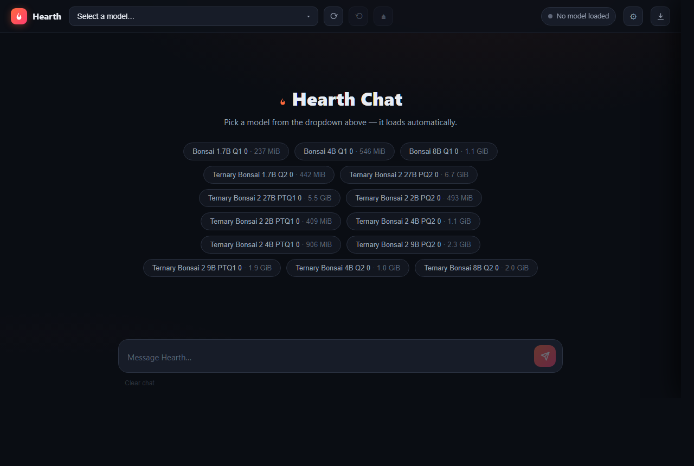
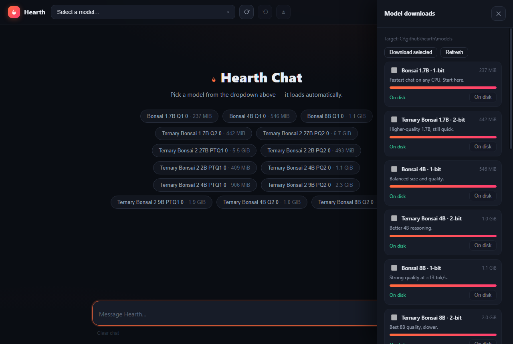

<div align="center">

# 🔥 Hearth

**Pure-Rust LLM inference — from GGUF file to generated token, zero C dependencies.**

[](https://github.com/Eric-Lautanen/hearth/actions/workflows/ci.yml)
[](LICENSE-MIT)
[](LICENSE-APACHE)
[](#quick-start)
[](https://rustup.rs)

*Local quantized models on CPU with hand-tuned SIMD kernels. One `cargo build` away.*

</div>

```
$ hearth-chat-cli model.gguf --temp 0 --max-tokens 100 --prompt "Explain quaternions"

Quaternions are a number system that extends complex numbers. A quaternion
has one real part and three imaginary parts: q = a + bi + cj + dk where
i² = j² = k² = ijk = -1. They're used extensively in 3D computer graphics
for rotation representation, avoiding gimbal lock...
```

## Screenshots





## Performance

14 models on AMD Ryzen 7 8840HS (Zen 4, 8C/16T, DDR5), one run each at
`--temp 0 --max-tokens 50 --prompt "Hello" --prompt-raw`, idle machine, warmed
up first. 8 workers. Single runs on this box vary: an interleaved re-run later
the same evening read the Q2_0 family ~25% lower on two independent binaries,
so treat these as snapshots — only alternating same-session pairs carry
information.

| Size | Format               | d_model | Layers | tok/s |
| ---- | -------------------- | ------- | ------ | ----- |
| 1.7B | Q1_0 (1-bit, 128-el) | 2048    | 28     | **47.1** |
| 1.7B | Q2_0 (2-bit ternary) | 2048    | 28     | **24.5** |
| 4B   | Q1_0 (1-bit, 128-el) | 2560    | 36     | **18.8** |
| 4B   | Q2_0 (2-bit ternary) | 2560    | 36     | **12.4** |
| 8B   | Q1_0 (1-bit, 128-el) | 4096    | 36     | **12.2** |
| 8B   | Q2_0 (2-bit ternary) | 4096    | 36     | **6.8** |
| 2B²  | PTQ1_0 (1-bit)       | —       | —      | **16.3** |
| 2B²  | PQ2_0 (2-bit)        | —       | —      | **17.8** |
| 4B²  | PTQ1_0 (1-bit)       | —       | —      | **6.6** |
| 4B²  | PQ2_0 (2-bit)        | —       | —      | **7.5** |
| 9B²  | PTQ1_0 (1-bit)       | —       | —      | **4.2** |
| 9B²  | PQ2_0 (2-bit)        | —       | —      | **4.8** |
| 27B² | PTQ1_0 (1-bit)       | —       | 64     | **1.35** |
| 27B² | PQ2_0 (2-bit)        | —       | 64     | **1.53** |

² = Ternary Bonsai 2 (`qwen35` hybrid). The 27B pair runs at ~1.4 tok/s, so
raise `--max-tokens` deliberately — the UI streams progress and reasoning live
instead of buffering a reply. Raw data: [`docs/BUG_TRACKER.md`](docs/BUG_TRACKER.md).

## Features

- **Pure Rust, no C** — GGUF parser, BPE tokenizer, sampler, quant kernels, KV cache, thread pool. No CMake, no `libllama`.
- **Hand-tuned SIMD** — Q1_0/Q2_0/Q8_0 dot products (AVX2 LUT + FMA, AVX-512 VNNI where it wins, per-kernel dispatch), SSE4.1 + scalar fallbacks.
- **Custom thread pool** — zero syscalls per dispatch, static L2-tiled partitioning, 5.93× scaling on 8 cores.
- **Model-driven defaults** — each GGUF's `general.sampling.*` and `context_length` are honored; flags override per field.
- **Web chat UI** — model dropdown, settings seeded from the model, live tok/s, collapsible `<think>` reasoning, **model downloader** (per-model progress, queued 1-by-1, resume), and closing the last tab shuts the server down.
- **TLS track** — `hearth-tls` is pure-std, zero-dependency crypto (SHA-256 → AES-GCM → X25519 → record layer) for a future hand-rolled download transport.

## Quantization formats

| Format           | Bits/elem | Block | Kernel              |
| ---------------- | --------- | ----- | ------------------- |
| Q1_0 / Q1_0_G128 | 1         | 128   | AVX2 LUT + FMA      |
| Q2_0             | 2         | 128   | AVX2 LUT / VNNI     |
| Q4_0 · Q4_1      | 4         | 32    | Portable (+ fusion) |
| Q5_0 · Q5_1      | 5         | 32    | Portable            |
| Q2_K · Q3_K · Q4_K · Q5_K · Q6_K | 2–6 | 256 | QK block dequant |
| Q8_0             | 8         | 32    | Portable + fusion   |
| F16 / F32        | —         | —     | matrixmultiply sgemm |

## Quick start

**Prerequisites:** [Rust](https://rustup.rs) 1.88+ · an x86_64 CPU with AVX2 + FMA +
F16C (the x86-64-v3 baseline this ships: Intel Haswell 2013+, AMD Zen 2017+). The
SSE4.1/scalar fallbacks and the AVX-512 VNNI kernels are chosen by a runtime probe, so
building with `RUSTFLAGS="-C target-cpu=x86-64"` runs on older parts instead
· a Bonsai GGUF in the project `models/` folder — easiest via the web UI's
download button (top-right), or manually from HuggingFace (`<repo>/resolve/main/<file>`):

| File | Size | Repo |
| ---- | ---- | ---- |
| `Bonsai-1.7B-Q1_0.gguf` | 237 MiB | [Bonsai-1.7B-gguf](https://huggingface.co/prism-ml/Bonsai-1.7B-gguf) |
| `Ternary-Bonsai-1.7B-Q2_0.gguf` | 442 MiB | [Ternary-Bonsai-1.7B-gguf](https://huggingface.co/prism-ml/Ternary-Bonsai-1.7B-gguf) |
| `Bonsai-4B-Q1_0.gguf` | 546 MiB | [Bonsai-4B-gguf](https://huggingface.co/prism-ml/Bonsai-4B-gguf) |
| `Ternary-Bonsai-4B-Q2_0.gguf` | 1.0 GiB | [Ternary-Bonsai-4B-gguf](https://huggingface.co/prism-ml/Ternary-Bonsai-4B-gguf) |
| `Bonsai-8B-Q1_0.gguf` | 1.1 GiB | [Bonsai-8B-gguf](https://huggingface.co/prism-ml/Bonsai-8B-gguf) |
| `Ternary-Bonsai-8B-Q2_0.gguf` | 2.0 GiB | [Ternary-Bonsai-8B-gguf](https://huggingface.co/prism-ml/Ternary-Bonsai-8B-gguf) |
| `Ternary-Bonsai-2-2B-PTQ1_0.gguf` | 409 MiB | [Ternary-Bonsai-2-2B-gguf](https://huggingface.co/prism-ml/Ternary-Bonsai-2-2B-gguf) |
| `Ternary-Bonsai-2-2B-PQ2_0.gguf` | 493 MiB | [Ternary-Bonsai-2-2B-gguf](https://huggingface.co/prism-ml/Ternary-Bonsai-2-2B-gguf) |
| `Ternary-Bonsai-2-4B-PTQ1_0.gguf` | 906 MiB | [Ternary-Bonsai-2-4B-gguf](https://huggingface.co/prism-ml/Ternary-Bonsai-2-4B-gguf) |
| `Ternary-Bonsai-2-4B-PQ2_0.gguf` | 1.1 GiB | [Ternary-Bonsai-2-4B-gguf](https://huggingface.co/prism-ml/Ternary-Bonsai-2-4B-gguf) |
| `Ternary-Bonsai-2-9B-PTQ1_0.gguf` | 1.9 GiB | [Ternary-Bonsai-2-9B-gguf](https://huggingface.co/prism-ml/Ternary-Bonsai-2-9B-gguf) |
| `Ternary-Bonsai-2-9B-PQ2_0.gguf` | 2.3 GiB | [Ternary-Bonsai-2-9B-gguf](https://huggingface.co/prism-ml/Ternary-Bonsai-2-9B-gguf) |
| `Ternary-Bonsai-2-27B-PTQ1_0.gguf` | 5.5 GiB | [Ternary-Bonsai-2-27B-gguf](https://huggingface.co/prism-ml/Ternary-Bonsai-2-27B-gguf) |
| `Ternary-Bonsai-2-27B-PQ2_0.gguf` | 6.7 GiB | [Ternary-Bonsai-2-27B-gguf](https://huggingface.co/prism-ml/Ternary-Bonsai-2-27B-gguf) |

**Build** (first build takes 2–5 min; `lto=fat`, x86_64 baseline `x86-64-v3`;
add `RUSTFLAGS="-C target-cpu=native"` for a max-perf local-only binary):

```bash
git clone https://github.com/Eric-Lautanen/hearth.git
cd hearth
cargo build --release
```

**Run** — one-shot, interactive, or web UI:

```bash
./target/release/hearth-chat-cli models/Bonsai-1.7B-Q1_0.gguf --temp 0 --max-tokens 20 --prompt "Hello" --prompt-raw
./target/release/hearth-chat-cli models/Ternary-Bonsai-1.7B-Q2_0.gguf --max-tokens 256
cargo build --release -p hearth-ui && ./target/release/hearth-ui   # http://127.0.0.1:8899
```

(`hearth-ui` opens the browser automatically; `--no-browser` and `--port N` available.
Closing the last tab shuts the server down ~25 s later. Interactive commands:
`/quit`, `/clear`, `/system <message>`, `/config`.)

**Downloader** (download icon, top-right): tick models, **Download selected** —
one file at a time, rest queue, each with its own bar, partials resume,
finished files appear in the dropdown. Custom `.gguf` URL row included.
Power options: `models/catalog.json` or `HEARTH_MODEL_CATALOG_JSON` overrides
the catalog; `HEARTH_DL_ALLOW_HTTP=1` permits plain-http mirrors.

**Security model:** the server binds `127.0.0.1` only — nothing off the
machine can reach it. On top of that it enforces same-machine `Host`
(kills DNS rebinding), rejects foreign `Origin` on state-changing calls
(plain `curl` has no `Origin` and is unaffected), and supports an opt-in
token for shared boxes: set `HEARTH_UI_TOKEN`, and every `/api/*` call must
carry it as `X-Hearth-Token` (or `?token=` for the event stream) — the UI
prompts once and remembers it.

### Flags & environment

Only set what you want to change — the rest follows the model:

| Flag | Default | What it does |
| ---- | ------- | ------------ |
| `<model.gguf>` | required | Model path first, no `--` prefix |
| `--temp` / `--top-k` / `--top-p` / `--min-p` | model's, else 0.7 / 40 / 0.9 / 0.0 | Sampling controls (`0` temp = deterministic) |
| `--typical-p` / `--repeat-pen` / `--seed` | 0.0 / 1.1 / random | Typical sampling, repetition penalty, fixed RNG |
| `--max-tokens` / `--max-context` | 512 / model's length | Reply budget, context window |
| `--prompt` / `--prompt-raw` | — | One-shot mode / skip the chat template |
| `--show-think` | off | Show `<think>` reasoning instead of hiding it |
| `--gpu` / `--gpu-layers N` | cpu | GPU load strategy |
| `--pin-weights` | off | Mmap vs RAM (leave off for 27B-scale on 16 GB — pinning 5.9 GB died silently) |
| `--service` / `--dump-info` / `--kv-f32` | — | UI backend mode / print metadata / compat flag |

| Variable | Default | What it does |
| -------- | ------- | ------------ |
| `HEARTH_MODELS_DIR` | repo `models/` | Model folder for UI + CLI resolution |
| `HEARTH_CTX_CAP` / `HEARTH_THREADS` | model's length / ~3/4 cores (hybrid only) | KV cap; worker count for the `qwen35` path (dense models use a fixed 8-worker pool) |
| `HEARTH_MODEL_CATALOG_JSON` / `HEARTH_DL_ALLOW_HTTP` / `HEARTH_NO_AUTO_SHUTDOWN` | built-in / off / off | Catalog override, http mirrors, keep UI up |
| `HEARTH_UI_TOKEN` | off (open) | Require a token on every `/api/*` call (header or `?token=`); the UI prompts once |

## Architecture

```
hearth-chat-cli ─ hearth-llm (inference engine, forward pass, thread pool)
                   ├─ hearth-core · hearth-gguf · hearth-quant
                   ├─ hearth-tokenizer · hearth-sampler · hearth-compute (GPU stubs)
hearth-ui (web chat + downloader, drives hearth-chat-cli --service)
hearth-tls (hand-rolled TLS track) · hearth-diffusion (experimental images)
```

Each crate builds standalone (`hearth-gguf`, `hearth-quant`, `hearth-tokenizer`
are reusable on their own). The pool dispatches matmuls with zero syscalls and
static L2-tiled partitioning (5.93× on 8 cores); the Q1_0 kernel expands 1-bit
signs through a 2 KB LUT into AVX2 FMA accumulation with a single horizontal
sum per row. Details: [`docs/`](docs/).

## License

MIT or Apache-2.0, at your option — see [LICENSE-MIT](LICENSE-MIT) and [LICENSE-APACHE](LICENSE-APACHE).
